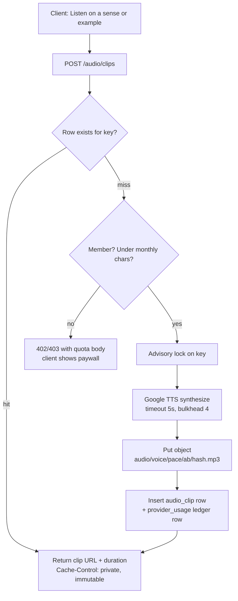

# Discover: feature design

2026-09-19 · @Someone

## What Discover is

Discover is the word sheet: a learner arrives with a word, phrase, or selected sentence and leaves with a saved learning item in one tap. The product vision names it the original center of the product; Reader, Review, sharing and Play all grew around it. It already exists as a thin public slice in all three clients, so this design is a second iteration, not a greenfield feature.

The sheet has to answer five questions fast, in this order: what does it mean here, how is it pronounced, is it worth learning now, what context should I keep, can I save it in one tap. Everything else on the sheet (morphology, examples, family, corrections) is specialist depth reachable without slowing the ordinary path.

| Surface | Today | Route |
| --- | --- | --- |
| Backend | Public lookup: provider senses + ngrams.dev frequency band, no persistence, no cache | `GET /public/discover/lookup/{lang}/{translationLang}` |
| Web (Angular) | One client-rendered page; sentence paste, token sheet, Keep to `POST /cards`, Reader "Look up" hand-off | `/discover` |
| Mobile (Expo) | Same lookup DTO, one dynamic screen | `app/d/[id].tsx` |
| Audio | Authenticated, uncached, `no-store` Google TTS endpoint, unused by Discover | `GET /lang/words/{text}/audio/{lang}` |

The frontend's implementation log lists eighteen gaps against the mockup. The ones that shape this design: no canonical lexical entry shared across visitors, no sense identity, no encounter history, no audio, no provider caching, no public indexable word URLs. Audio is the first one we take on because it is the only per-user scaling cost in the product and its cache design decides the storage shape everything else reuses.

## What already exists

The pieces Discover needs are mostly present but disconnected: a lookup endpoint with no persistence, a TTS client with no cache, an entitlement model with no audio feature, a spend page that does not see Google, and a host with local disk but no object store.

| Area | What is there | Where | Gap for Discover |
| --- | --- | --- | --- |
| Lookup | Provider senses (Yandex/Google via `LanguageProcessor`), ngrams.dev relative frequency scaled to 0–100 for EN, DE, RU | `analyzer/analyzer` | Nothing persisted; every visitor pays the provider call again |
| TTS | Google Cloud TTS client, MP3, `NEUTRAL` gender, no voice name, no speaking rate, synchronous per request | `GoogleTranslationServiceImpl`, `GoogleCloudConfig` | No cache, no slow variant, no voice pinning, response marked `no-store` |
| Audio endpoint | Authenticated, text in the path, attachment disposition | `LangController.bulkPronounce` | Not public, not cacheable, not called by any Discover client |
| Learning item | `entry`, `selectedSense` (text), intents incl. `PRONOUNCE`, source context | `card/core` `LearningItem` | No sense FK, no canonical entry |
| Entitlements | `FREE`, `PREMIUM`, `UNLIMITED`; per-plan integer limits for langs, imports, translation requests | `subscription` `PlanFeature`, `PlanService` | No audio feature key, no per-user usage ledger |
| Spend page | Almo and Books token ledgers priced by table, OpenAI actuals | `infra/spend` | Google TTS and Translate spend not on the page |
| Rate limits | Policy doc proposes TTS 10/min/user, input ≤ 500 bytes, cache by content hash | `docs/RATE_LIMIT_POLICY.md` | Not implemented |
| Storage | Host-local Docker volumes only; Books mounts `media_root`; backups to Backblaze B2 | `almonium-infra` roles | No object store or CDN for the backend |
| Web client | Discover page with paste, token sheet, Keep; Reader "Look up" hand-off | `almonium-fe` `sections/discover` | No audio control |
| Mobile client | Reader word sheet with a speaker icon that opens the audio paywall; no Discover tab of its own | `almonium-mobile` `app/reader` | Speaker button is a paywall stub; `/d/:id` is shared packs, not Discover |
| Backlog | 1.19 LLM lexical entry write-through cached, 1.20 warm top 8–10k lemmas, 1.22 corrections, 1.23 `wordfreq`, 0.4 external-cost ledger | `docs/ALMONIUM_BACKLOG.md` | Not started |

The mockup fixes the product rule: the whole sheet is public because a lexical entry is written once and served to everyone; audio is a member line because it is spoken for one person at a time. The sheet shows two controls, Listen and Slowly. The mobile paywall copy already says audio belongs to the plan that covers it. Any cache design below must respect that rule: a cache hit is amortised and could be free, a miss is the linear cost that must be metered.

## Feature inventory

Discover is one page with twelve features. Three are foundations everything else keys off (canonical entry, sense identity, audio cache); the rest layer on top. Priority is the order to build, not importance.

| # | Feature | What it does | Depends on | Priority |
| --- | --- | --- | --- | --- |
| 1 | Audio: Listen and Slowly | Pronounce the headword (and later any example) at normal and slow pace; member-only, cached globally | Audio cache, entitlement key | Now |
| 2 | Canonical lexical entry | One stored, versioned entry per (language, lemma), LLM-generated to a strict schema, served to every visitor; first lookup pays, later lookups are a DB read | Backlog 1.19 | Now |
| 3 | Sense identity | `Sense` as a row with a stable id; `LearningItem.selectedSense` becomes a FK; keeping the same sense twice is prevented | 2 | Now |
| 4 | Frequency with provenance | Per-million count, rank, register band (print vs speech), corpus label; `wordfreq` offline replaces ngrams.dev | Backlog 1.23 | Next |
| 5 | Meaning in every fluent language | Translations per sense for all of the learner's fluent languages, one for signed-out | 2, 3 | Next |
| 6 | Sentence paste and token sheet | Already shipped; extend to a paragraph for members, keep the source sentence on Keep | — | Shipped |
| 7 | Reader hand-off | Reader selection opens the same sheet inline without losing position | 6 | Next |
| 8 | Encounter history | Record every lookup; show "looked up, not kept" and counts; twice is the signal to keep | Lookup event table | Next |
| 9 | Word family and morphology | Prefix/root/stem, living family capped at six visible, ordered by frequency | 2 | Later |
| 10 | Contextual sense pick | Given the source sentence, pre-select the likely sense | 2, 3 | Later |
| 11 | Corrections and provenance | Version, generation date, model and prompt version, "suggest a correction" queue; corrections become gold data | 2 | Later |
| 12 | Public word URLs and SSR | Server-rendered `/de/ausgabe` pages with backlinks to books; the SEO argument for the page | 2, 4 | Later |
| 13 | From the chapter you are in | Above-level, not-yet-kept words from the current chapter; needs token-level book index | Books processor | Later |
| 14 | Ranked autocomplete | Multilingual suggestions from the canonical entry index | 2 | Later |

Two entitlement rules run through the table. Lookups, senses, frequency and family are free and public because the entry is written once. Audio and the 100-word Keep cap are the member lines; the Keep cap needs a backend invariant before the client can show a trustworthy count.

## TTS deep dive

Yes, build a global cache: index in Postgres, bytes in object storage, generate on miss, and bound the key space so it cannot grow past what the product can ask for. Stay on Google, move from an unnamed neutral voice to a pinned Chirp 3: HD voice per language, and put the voice name in the cache key. Word audio is not the linear cost the strategy docs fear; whole-book narration is. A cached word clip is written once and served forever, exactly like a lexical entry.

### What is important

1. **Bounded key space.** Tens of millions of records only happen if we synthesize arbitrary user text. Headwords and canonical examples for one language are a few hundred thousand to a few million clips. Once canonical entries exist, the client asks for audio by sense or example id, never by free text. Free text (sentence paste, Reader selections) is a separate metered path with eviction.
2. **Bytes never in Postgres.** A one-second MP3 is about 5 KB; ten million clips are about 50 GB. That in `bytea` bloats WAL, vacuum, and the Backblaze backups. The row holds a key, sizes and provenance; the object store holds audio.
3. **Deterministic key.** `sha256(provider · voice · pace · format · language · normalized text)`. Normalization is NFC, trim, collapse whitespace, case preserved. A voice or provider change gets a new key, so mixed voices are never served for one word.
4. **Hits are amortised, misses cost money, and the learner sees neither.** A hit costs a row read and 5 KB of egress. A miss is the provider call and lands in the cost ledger. Whether a word was already generated by someone else is an infrastructure fact, so it never shapes a quota the learner can see: headword and example audio is a plan feature, on or off, and only free-text audio is metered, hit or miss alike.
5. **Warm before anyone asks.** Creating a canonical entry enqueues its headword; the top 10k lemmas for DE and EN are about 160k characters, inside Google's free tier. Discover's Listen is then a hit almost always.
6. **Single-flight across the two app slots.** A Postgres advisory lock on the key makes two concurrent misses synthesize once.
7. **Never update the row on a hit.** At scale, a hit counter is write amplification. Usage goes to PostHog events or the ledger, not the clip row.

### Request flow



The clip URL is the backend streaming the object with a one-year immutable cache header and the key as ETag; the browser and the mobile cache then never ask again. The clip carries no user data, so once it is served from an object store or CDN URL it is `public`; while it is proxied through the authenticated backend it stays `private` so a shared cache that ignores cookies cannot hand it to a visitor who never obtained the URL. Presigned object URLs are the step after that if proxying ever shows up in CPU.

### Provider choice

Prices as of 2026-09-19 from the vendor pages linked. Google is already integrated and credentialed, covers every fluent and target language in the plan, and its free tier absorbs the warm-up.

| Provider and tier | Price per 1M chars | Free per month | Slow pace | Notes |
| --- | --- | --- | --- | --- |
| [Google Chirp 3: HD](https://cloud.google.com/text-to-speech/pricing) | $30 | 1M chars | `speaking_rate` 0.25x–2x | 58 languages incl. de-DE, uk-UA, ru-RU, pl-PL; 29 named voices; SSML in preview ([docs](https://docs.cloud.google.com/text-to-speech/docs/chirp3-hd)) |
| Google Neural2 | $16 | 1M chars | SSML `prosody`, `speakingRate` | Fewer locales; SSML `<mark>` timepoints for future narration |
| Google WaveNet / Standard | $4 | 4M chars | SSML, `speakingRate` | Widest locale list; fallback where Chirp has no voice |
| [OpenAI gpt-4o-mini-tts](https://developers.openai.com/api/docs/pricing) | $12 per 1M audio tokens | none | prompt-steered | 25 tokens per second of audio, so about $0.0003 per one-second clip; no per-language voice pinning |
| OpenAI tts-1 / tts-1-hd | $15 / $30 | none | `speed` | English-centric accents in other languages |
| [ElevenLabs Flash / Multilingual](https://elevenlabs.io/pricing/api) | $50 / $100 | none, plans from $6 | yes | Best expressiveness, worst unit price, plan-shaped billing |
| [Amazon Polly Neural / Generative](https://aws.amazon.com/polly/pricing/) | $16 / $30 | 1M chars first 12 months | SSML | New AWS account and credentials for one feature |
| [Azure Neural](https://azure.microsoft.com/en-us/pricing/details/cognitive-services/speech-services/) | page shows no figure without a region; roughly $15 (approximate) | 0.5M chars | SSML | New Azure account |

Recommendation: Chirp 3: HD for de-DE and en-US, WaveNet where Chirp has no voice, one pinned voice name per language in configuration. A per-word clip of eight characters costs $0.00024 on Chirp and $0.00003 on WaveNet before caching. Quotas on Google's side are 5,000 bytes per request and 1,000 requests per minute per project ([quotas](https://docs.cloud.google.com/text-to-speech/quotas)); lower the project quota to a budget-safe ceiling so the application is not the last financial defence.

### Self-hosted TTS

Run a half-day benchmark on the A1 host before pinning Google, but do not block the build on it: the `TtsSynthesizer` port makes the engine a configuration choice, and the cache means the engine can change per voice key without touching anything else. The honest expectation is that a local engine wins on price for free-text and narration and loses on isolated-word pronunciation quality, which is the one thing Discover audio is for.

Checked 2026-09-19 against the project pages linked. Kokoro is out: it has no German, Ukrainian, Russian or Polish. Chatterbox is a 0.5B model that expects a GPU. Two candidates remain.

| Engine | License | Languages we need | ARM64 CPU | Quality | Caveats |
| --- | --- | --- | --- | --- | --- |
| [Piper](https://github.com/OHF-Voice/piper1-gpl) 1.8.0 | GPL-3.0 engine (run as a separate process); voices per dataset | de, en, uk, ru, pl, fr, es, one small VITS model per voice | manylinux aarch64 wheels on [PyPI](https://pypi.org/project/piper-tts/); RTF about 0.1 for a medium voice and 0.65 for a high voice on a Cortex-A76 board ([measured](https://turingpi.com/whisper-cpp-piper-tts-arm64-turing-pi-rk3588/)) | 2023-era VITS, 22 kHz, intelligible but audibly synthetic; espeak-ng rule-based G2P, so stress on rare words is the risk | Voice datasets differ: `de_DE-thorsten` CC0, `uk_UA-ukrainian_tts` CC0, `pl_PL-gosia` CC0, `ru_RU-irina` unknown, `ru_RU-ruslan` CC BY-NC-SA, `en_US-lessac` Blizzard 2013 terms. Only CC0 voices are safe for a paid product without a licensing pass |
| [Supertonic 3](https://github.com/supertone-inc/supertonic) (April 2026) | OpenRAIL-M model, MIT code; commercial use allowed with use restrictions | One 99M multilingual ONNX model, 31 languages incl. de, en, uk, ru, pl, fr, es | ONNX Runtime; average RTF 0.3x on a Raspberry Pi per the project | Newer architecture than Piper; six preset voices; reading accuracy is a stated focus | Six voices shared across languages, so no native-speaker voice per language; young project, verify Ukrainian and German pronunciation by ear |
| [Kokoro 82M](https://github.com/hexgrad/kokoro) | Apache-2.0 | en, es, fr, hi, it, ja, pt, zh only | ONNX on CPU | Good English | No German, Ukrainian, Russian, Polish; not a fit |
| [Chatterbox Multilingual](https://huggingface.co/ResembleAI/chatterbox) | MIT | 23 languages incl. de, ru, pl; no uk | 0.5B parameters, documented for CUDA | Strong | Too heavy for a shared 4-core ARM host |

Capacity on the host: a one-second word clip is about 0.1 to 0.3 s of one core with a Piper medium voice, so four cores sustain roughly 10 to 30 clips per second, far above any warm-up or live need. Memory is 100 to 200 MB per loaded voice. The host also runs two backend slots, Postgres, RabbitMQ, the Books worker and the media stack, so the engine gets a CPU and memory limit in Compose and a bulkhead in the app. The Google free tier already covers the warm-up, so the only money a local engine saves is misses beyond 1M characters a month, which the cost model above puts at cents per member.

Benchmark plan, half a day, no product code:

1. Install Piper and Supertonic in a scratch container on the A1 host; load `de_DE-thorsten-high`, `uk_UA-ukrainian_tts-medium`, an `en_US` CC0 voice, and the Supertonic multilingual model.
2. Synthesize the same 50 German headwords (mixed frequency, several with movable stress and separable prefixes), 20 Ukrainian and 20 English headwords, and 10 sentences each, on Chirp 3: HD, Piper and Supertonic.
3. Record wall time per clip at 1 and 4 concurrent requests, and peak memory.
4. Blind-listen the three sets for stress, vowel quality and naturalness; the owner and one native speaker per language score each clip pass or fail.
5. Decide per kind: headwords and examples take the engine that passes the listening test; free-text and future narration take the cheapest engine that passes.

If a local engine passes, it runs as a small HTTP sidecar (Piper ships one) on the host, called by `LocalTtsSynthesizer`, with `GoogleTtsSynthesizer` as fallback when the sidecar is down or a language has no approved voice. The engine and voice name are already in the cache key, so a switch never mixes generations.

### Warm-up and bulk sources

There is nothing worth buying: the only commercial bulk source forbids caching, and the free human-recorded corpus is a quality upgrade rather than a cost saving. The warm-up is a resumable background job that walks a frequency list and fills misses, and it is optional for launch because a cold cache costs one 400 ms wait per word for the first learner.

| Source | What it is | Licence | Fit |
| --- | --- | --- | --- |
| [Lingua Libre](https://commons.wikimedia.org/wiki/Help:Lingua_Libre/Download_datasets/en) via Wikimedia Commons | Over a million native-speaker word recordings, downloadable as one zip per language, about 100 KB each | CC BY-SA 4.0 per file, attribution to the speaker | Best possible quality for the words it covers; coverage of the top 20k lemmas is uneven and unverified for German and Ukrainian; needs a speaker credit on the sheet |
| [Forvo API](https://api.forvo.com/plans-and-pricing/) | 4M crowd pronunciations | Commercial plan $28.95 a month for 10,000 requests a day, attribution required; audio links expire after 2 hours and caching audio is not allowed | Not usable with a cache; would be a per-play upstream call, the opposite of this design |
| Dictionary publishers (Oxford, Collins, PONS, Duden) | Editorial audio | Negotiated licences, not tens of dollars | Out of scope |
| Google Chirp 3: HD | Generated | 1M characters a month free | Top 20k lemmas for one language is about 160k characters, so the whole warm-up for DE and EN fits inside one month's free tier |

How the warm-up runs:

1. A one-off script with [`wordfreq`](https://github.com/rspeer/wordfreq) (`top_n_list('de', 20000)`, data CC BY-SA, snapshot of 2021) writes one CSV per language into the backend resources, the way the translator seed CSV is shipped today.
2. An internal endpoint, `POST /internal/audio/warm-up?lang=DE&top=20000`, on the same internal boundary as the Books publication hooks, starts the job; a `@Scheduled` nightly pass is not needed.
3. The job walks the list, computes each key, skips rows that exist, and synthesizes the rest through the same `AudioClipService` miss path with a concurrency of 5 and a per-run character budget. Google allows 1,000 requests a minute; at 5 in flight and 400 ms each, 20k words take about 30 minutes.
4. Every clip lands as `kind = HEADWORD` with the ledger row marked `user_id = null`, so the spend page shows the warm-up as its own line.
5. The job is idempotent and resumable: stopping it and starting it again costs nothing, and re-running after a voice change fills only the new voice's keys.
6. Once canonical entries exist, entry creation enqueues the headword, and the CSV job becomes the fallback for languages without entries.

If Lingua Libre coverage turns out good for German, the job can prefer a human recording where one exists and fall back to synthesis: the row's `provider` becomes `linguallibre`, the object is the original file transcoded to MP3, and the sheet shows the speaker credit the licence asks for.

### Storage

| Option | Storage per GB-month | Egress | Free | Fit |
| --- | --- | --- | --- | --- |
| OCI Object Storage (same cloud as the host) | about $0.0255 (approximate, from third-party summaries; Oracle's page refused the fetch) | first 10 TB per month free | 10 GB always free | Lowest latency to the app; S3-compatible API |
| [Cloudflare R2](https://developers.cloudflare.com/r2/pricing/) | $0.015 | free | 10 GB, 1M Class A, 10M Class B | Zero egress forever; natural CDN front if clips ever go public |
| [Backblaze B2](https://www.backblaze.com/cloud-storage/pricing) | $6.95 per TB | 3x stored free, then $0.01 | 10 GB | Already the backup target; free egress via Cloudflare |
| Host Docker volume | free | free | host disk | Simplest, but outside the backup story and shared by both slots |

All three clouds speak S3, so one `AudioStore` adapter with an S3 client covers them, and a filesystem implementation serves the `local` profile. Ten million clips at 5 KB is 50 GB, about $1.30 a month on OCI or $0.75 on R2. Storage is not the cost; provider characters are.

### Cost model per member

One row per assumption so the owner can change any of them.

| Assumption | Value |
| --- | --- |
| Plays per session | 40 |
| Sessions per month | 20 |
| Miss rate after warm-up | 10% |
| Characters per miss (word / example sentence) | 8 / 80 |
| Chirp price per character | $0.00003 |
| Monthly provider cost per member, words only | $0.02 |
| Monthly provider cost per member, all misses are sentences | $0.19 |

Against a $12 plan this is noise. The cost that scales is narrating a novel: a 100k-word book is about 600k characters, $18 on Chirp per edition per voice, and that belongs to the ebook pipeline with its own gate, not to this cache.

### Slow pace

Two ways, and the cache key carries `pace` either way. Client-side: play the same clip at rate 0.7 with pitch preservation, which browsers and Expo support, so one synthesis serves both buttons. Provider-side: a second synthesis at `speaking_rate` 0.7 with better prosody at double the miss cost and storage. Start client-side; add provider-side slow for the PRONOUNCE intent in Review if learners ask for it.

### Schema

```sql
create table audio_clip (
  key           bytea primary key,          -- sha256 of the key tuple
  language      varchar(8)  not null,
  text          text        not null,        -- normalized, <= 200 bytes for free text
  kind          varchar(16) not null,        -- HEADWORD | EXAMPLE | FREE_TEXT
  provider      varchar(32) not null,        -- google
  voice         varchar(64) not null,        -- de-DE-Chirp3-HD-Kore
  pace          numeric(3,2) not null,       -- 1.00
  format        varchar(16) not null,        -- mp3
  object_key    text        not null,
  byte_size     integer     not null,
  duration_ms   integer     not null,
  chars_billed  integer     not null,
  created_at    timestamptz not null default now()
);
create index on audio_clip (kind, created_at) where kind = 'FREE_TEXT';  -- eviction scan

create table provider_usage (
  id            bigserial primary key,
  user_id       bigint references user_core(id),
  feature       varchar(32) not null,        -- TTS_CLIP
  provider      varchar(32) not null,
  model         varchar(64) not null,        -- voice name
  units         integer     not null,        -- characters
  cost_usd      numeric(12,6) not null,
  created_at    timestamptz not null default now()
);
create index on provider_usage (user_id, feature, created_at);
```

Ten million rows of `audio_clip` are about 2 GB with the index. No partitioning is needed; `provider_usage` gets month partitions if it ever grows past the review-event table. The ledger is backlog item 0.4 and serves every metered feature, not only audio.

### Entitlement and limits

- Headword and example audio is a boolean plan feature, `AUDIO_CLIPS`, no character quota: FREE off, PREMIUM and UNLIMITED on. Free-text audio, if shipped, is metered by `MAX_TTS_FREE_TEXT_CHARS_PER_MONTH` counted from `provider_usage` over the billing period, charged on every request whether or not it was a hit, so the number the learner sees never depends on what other learners generated. Seed FREE 0, PREMIUM 50,000, UNLIMITED absent.
- Hits and misses look the same to the learner. Whether free accounts may play hits is a product decision; the code keeps that rule in one policy class so it can flip without touching the cache.
- Abuse protection instead of quota for headwords: 30 plays and 10 misses a minute per user, text at most 200 UTF-8 bytes for free text, a bulkhead of 4 concurrent provider calls, a 5-second deadline.
- Google TTS gets its own estimated line on the ops spend page from the ledger; a local engine's line is zero dollars but still counts characters.

## TTS cross-repo change plan

Four repositories change, in this order: infra first so the object store and its credentials exist, backend second, then the two clients against a deployed staging endpoint. Each step is its own commit in its own repository.

| Order | Repo | Change | Notes |
| --- | --- | --- | --- |
| 1 | almonium-infra | Create the bucket and an S3-compatible access key; add `AUDIO_STORE_*` to the vault schema, encrypted values, and the backend Compose environment mapping | Schema documents the shape only; values stay in the vault |
| 2 | almonium-be | `.env.template` and `application.yaml` bindings for `audio.store.endpoint`, `bucket`, `region`, `access-key`, `secret-key`, and `audio.tts.voices` (a map of language to voice name); `local` profile points the store at a filesystem directory | Reconcile binding, validation, template and Compose mapping in one commit |
| 3 | almonium-be | Liquibase: `audio_clip`, `provider_usage`, `plan_limit` rows for `AUDIO_CLIPS` and, if free-text ships, `MAX_TTS_FREE_TEXT_CHARS_PER_MONTH` | Additive; the old slot ignores the new tables |
| 4 | almonium-be | New `learning/audio` package: `AudioClipService` (key, hit or miss, single-flight), `AudioStore` port with S3 and filesystem adapters, `TtsSynthesizer` port with the Google adapter moved out of `GoogleTranslationServiceImpl`, `AudioClipController` at `POST /audio/clips` and `GET /audio/clips/{key}` | Keeps the controller thin and the provider behind an adapter |
| 5 | almonium-be | `ProviderUsageLedger` in `infra/spend`, quota check through `PlanValidationService`, Google TTS line on the spend report | Ledger is shared by later metered features |
| 6 | almonium-be | Delete `LangController.bulkPronounce` and `TranslationService.textToSpeech`; no client calls them | Behaviour change, separate commit from the refactor |
| 7 | almonium-be | Warm-up job: on canonical entry creation and a one-off command for the top lemmas | Lands with feature 2; until then a manual admin trigger |
| 8 | almonium-fe | `AudioService` calling the clip endpoint, Listen and Slowly on the Discover sheet, paywall on 402/403, `playbackRate` 0.7 with `preservesPitch` for Slowly | The sheet already has the heading row where the controls go |
| 9 | almonium-mobile | Add `expo-audio` (nothing plays audio today), same service against the bearer flow, replace the Reader speaker paywall stub with real playback for members | Keep the native bearer boundary; no cookie path |
| 10 | almonium-mobile, almonium-fe | Paywall copy: the current text promises narrated books; word audio needs its own line | Cross-client contract change |

Error contract: a miss over quota returns 402 with `{limit, used, periodEndsAt}` in the shape of the translation quota DTO, so both clients render the same paywall from one response. A provider failure returns 503 with a retry hint and never a cached row.

Tests: unit tests for key normalization and single-flight, a Testcontainers test for hit and miss against the filesystem store with a mocked synthesizer, a quota test across the billing period, and a client test per surface for the 402 path.

## Open questions

- [ ] **Free accounts and cache hits.** The mockup says audio is a member line. A hit costs nothing linear, so free accounts could play warmed headwords and members alone trigger generation. Member-only is the default in this doc; the alternative strengthens the free demo and weakens the premium pitch.
- [ ] **Local engine spike.** Run the half-day Piper and Supertonic benchmark on the A1 host before or alongside the Google build; the listening test decides, not the price.
- [ ] **Object store.** OCI Object Storage next to the host, or Cloudflare R2 for free egress and a CDN in front of public word pages later. The adapter is the same either way.
- [ ] **Slow pace.** Client-side rate 0.7 on one clip, or a second provider synthesis per word.
- [ ] **Voice per language.** One pinned Chirp 3: HD voice for de-DE and en-US to start; a listening pass to choose the names before they go into the key.
- [ ] **Free-text audio at all in v1.** Headword and example audio bounds the cache; sentence-paste audio is the unbounded path. Ship without it, or ship it metered with eviction.
- [ ] **Premium free-text allowance.** 50,000 characters a month is a placeholder; it maps to about 600 sentences.
- [ ] **Order against canonical entries.** Text-keyed audio can ship before feature 2; id-keyed audio is cleaner. Text-keyed first means one migration later that reattaches clips to senses by normalized text.
